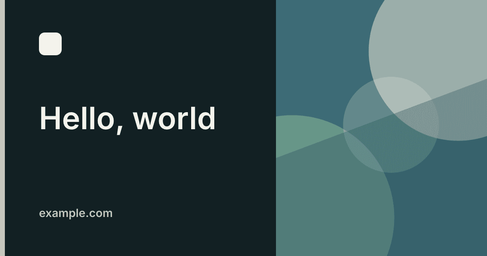

# astro-og-kit

> [!WARNING]
> **Experimental.** 0.x releases. The API may change in any release
> until 1.0. Pin an exact version.

Build-time Open Graph images for Astro. SVG templates, rendered to PNG with
[resvg](https://github.com/yisibl/resvg-js).

## Install

```sh
npm i astro-og-kit
```

## Quick start

**1.** `src/og.ts` — `font` is the only required key:

```ts
import { defineOg } from 'astro-og-kit'

export const og = defineOg({
  font: { family: 'Inter', files: ['src/assets/Inter.ttf'] },
})
```

**2.** `astro.config.mjs`:

```js
import ogKit from 'astro-og-kit/integration'
import { defineConfig } from 'astro/config'
import { og } from './src/og'

export default defineConfig({
  integrations: [ogKit(og)],
  site: 'https://example.com',
})
```

**3.** In your layout `<head>`:

```astro
---
import OgMeta from 'astro-og-kit/OgMeta.astro'
---

<OgMeta title={title} />
```

Every prerendered page that renders `<OgMeta>` gets a PNG at its `og:image` URL.
Set `site` in `astro.config` so image URLs are absolute. `heading` is the text
drawn on the image (defaults to `title`). `photo` is the card photo (pass the
imported image, not `.src`). `image` overrides `og:image` and skips generation.

On-demand pages get no build-time PNG. Use `og.route()` in
`src/pages/og/[...slug].png.ts` (`export const prerender = true`), or pass
`image`. Without the integration, pass `og={og}` to `<OgMeta>`.

## Brand

```ts
const colors = {
  accent: '#c6c6bd',
  background: '#122023',
  foreground: '#f4f3ec',
  muted: '#c6c6bd',
}

export const og = defineOg({
  font: { family: 'Inter', files: ['src/assets/Inter.ttf'], weight: 600 },
  colors,
  logo: { src: 'src/assets/logo.svg', width: 72 },
  footer: 'example.com',
  photo: 'src/assets/hero.jpg',
})
```

`colors` keys are optional. `overlay` (tint over a full-bleed photo) defaults to
`background`. `colors.logo` defaults to `foreground` and recolors the SVG;
`false` keeps the file's own colors. `photo` is a path, an import, or
`{ src, position }` (`left` / `center` / `right` / `top` / `bottom`).

## Layout

### split (default)



Title on the left, photo (if any) in a panel on the right.

```ts
import { defineOg, split } from 'astro-og-kit'

export const og = defineOg({
  font: { family: 'Inter', files: ['src/assets/Inter.ttf'] },
  template: split({ lineHeight: 1.16 }),
})
```

### cover


Full-bleed photo behind the title, with a tinted overlay.

```ts
import { cover, defineOg } from 'astro-og-kit'

export const og = defineOg({
  font: { family: 'Inter', files: ['src/assets/Inter.ttf'] },
  photo: 'src/assets/hero.jpg',
  template: cover({ opacity: 0.72, maxWidth: 640 }),
})
```

Options: `size`, `lineHeight`, `maxWidth`, `maxLines`, `accentBar`, and
`opacity` (`cover` only). Each has a default; pass only what you change.

## Custom template

<table>
<tr>
<td>

```ts
import { defineOg, svg, type OgTemplate } from 'astro-og-kit'

const card: OgTemplate = ({ colors, font, height, logo, page, width }) => svg`
  <svg xmlns="http://www.w3.org/2000/svg" width="${width}" height="${height}">
    <rect width="100%" height="100%" fill="${colors.background}" />
    ${logo?.at(96, 80)}
    <text x="96" y="360" font-family="${font.family}" font-size="80"
      fill="${colors.foreground}">${page.title}</text>
  </svg>`

export const og = defineOg({
  font: { family: 'Inter', files: ['src/assets/Inter.ttf'] },
  colors: { background: '#122023', foreground: '#f4f3ec' },
  logo: { src: 'docs/logo.svg', width: 56 },
  template: card,
})
```

</td>
<td>

</td>
</tr>
</table>

## Page

On `<OgMeta>` or `og.route()`: `title`, `heading`, `description`, `photo`,
`image` (OgMeta only; skips the PNG), `colors`, `logo` (`false` hides it),
`footer` (`false` hides it), `template` (`'split'` or `'cover'` on OgMeta),
`data`, `pathname` (route records). `WIDTH` and `HEIGHT` (`1200`, `630`) are
exported for custom templates.

## Build

```ts
export const og = defineOg({
  font: { family: 'Inter', files: ['src/assets/Inter.ttf'] },
  output: { path: '/og', compress: true, cache: 'node_modules/.astro-og-kit' },
})
```

All optional. `path` is the image route (not Astro's `base`). `cache: false`
turns the cache off.

## Full config

```ts
import { defineOg, split } from 'astro-og-kit'

const colors = {
  accent: '#c6c6bd',
  background: '#122023',
  foreground: '#f4f3ec',
  muted: '#c6c6bd',
  overlay: '#122023',
}

export const og = defineOg({
  font: { family: 'Inter', files: ['src/assets/fonts/Inter-SemiBold.ttf'], weight: 600 },
  colors,
  logo: { src: 'src/assets/logo.svg', width: 72 },
  footer: 'example.com',
  photo: 'src/assets/hero.jpg',
  template: split({ lineHeight: 1.16 }),
  output: { path: '/og', compress: true, cache: 'node_modules/.astro-og-kit' },
})
```

`cover({ opacity: 0.72, maxWidth: 640 })` instead of `split` for a full-bleed
photo. `colors.logo: false` keeps the SVG's own fills.

## More

[split](examples/split), [cover](examples/cover), and [custom](examples/custom)
examples. `npm test`, `npm run examples`, and `npm run docs:images`.

0.x releases: see [RELEASING.md](RELEASING.md).

## License

MIT
